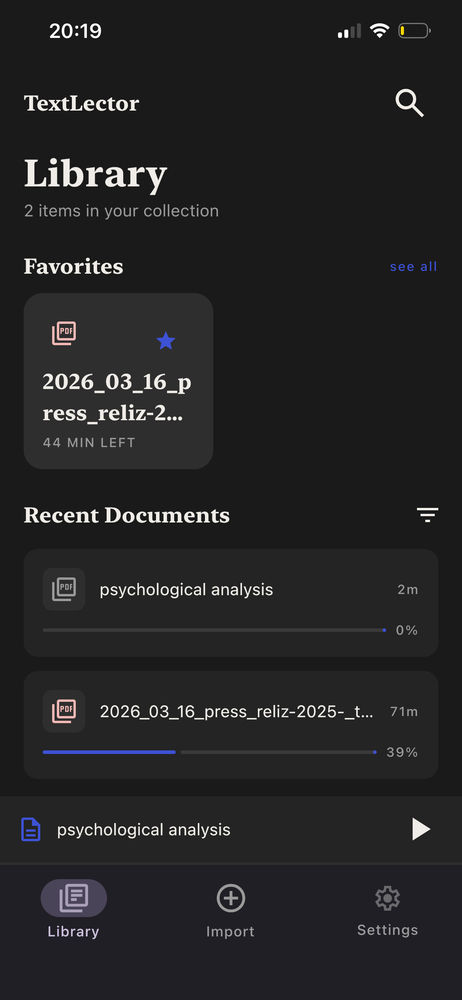
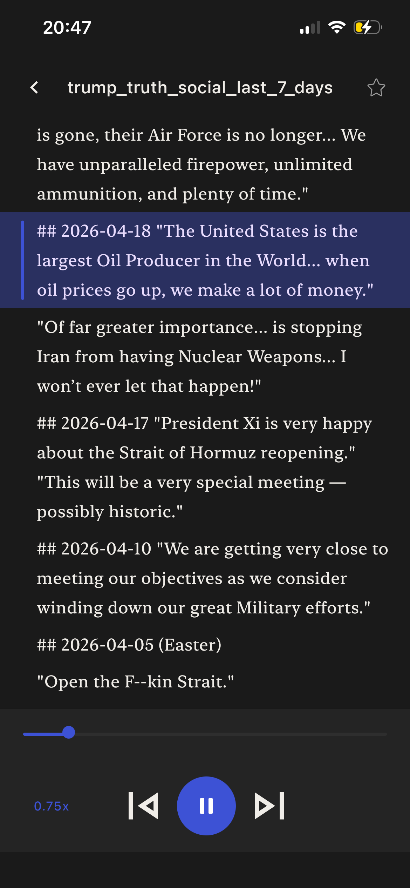
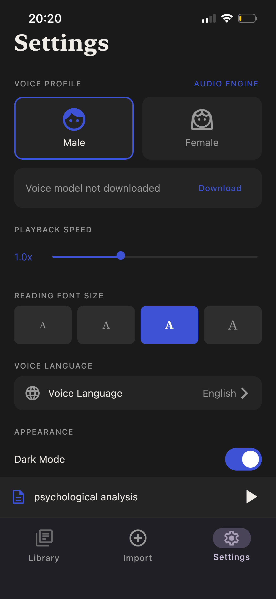

# TextLector

[](https://kotlinlang.org/)
[](https://www.jetbrains.com/compose-multiplatform/)
[]()
[]()
[](https://github.com/nedmah/TextLector/releases)

A free, offline text-to-speech reader for Android and iOS, built with Kotlin Multiplatform and Compose Multiplatform.

> Open-source alternative to Speechify — no subscriptions, no internet required, no data leaves your device.

---

## Demo

https://github.com/user-attachments/assets/0756bb22-88df-4ab7-adac-295487bf5d66

---

## Screenshots

<p float="left">
  
  
  
</p>

---

## Features

- **Import** — PDF, TXT (UTF-8 / windows-1251), EPUB, FB2 (incl. `.fb2.zip`), URL, camera (OCR), or paste text manually
- **Offline TTS** — three engines: system voices, Piper (neural, ~63 MB per voice), Supertonic (highest quality, ~145 MB)
- **Paragraph highlighting** — current paragraph highlighted in sync with playback
- **Reading progress** — app remembers where you stopped in every document
- **Library** — manage documents, mark favorites, sort by date
- **Adjustable playback** — speed control (0.5x–2.0x), voice gender, language, font size
- **Switch engines at runtime** — no app restart required

---

## TTS Architecture

TextLector uses a three-tier TTS system managed by a single `SwitchableTtsEngine`.

**Tier 1 — System TTS (default)**
Android `TextToSpeech` and iOS `AVSpeechSynthesizer` — available immediately, no downloads.

**Tier 2 — Neural TTS via Piper / sherpa-onnx**
[sherpa-onnx](https://github.com/k2-fsa/sherpa-onnx) bundles ONNX Runtime and eSpeak-NG. Piper VITS models (~63 MB each) are downloaded on demand from HuggingFace and stored locally.

| Voice  | Language | Gender |
|--------|----------|--------|
| Ruslan | Russian  | Male   |
| Irina  | Russian  | Female |
| Ryan   | English  | Male   |
| Lessac | English  | Female |

**Tier 3 — Neural TTS via Supertonic / sherpa-onnx**
[Supertonic 3](https://github.com/supertone-inc/supertonic) by Supertone Inc., run through sherpa-onnx's built-in Supertonic support. Flow-matching synthesis with 10 voices (M1–M5, F1–F5); one multilingual model serves both Russian and English. The int8 model (~145 MB) is downloaded once from HuggingFace, file by file (interrupted downloads resume), then works fully offline.

Compared to Piper: higher naturalness, but slower generation on mobile CPU. `SupertonicModel.NUM_STEPS` trades quality for speed.

Both ONNX-based engines use a shared `TtsQueue` that prefetches the next paragraph in the background while the current one plays.

---

## Tech Stack

| Layer         | Technology                                                 |
|---------------|------------------------------------------------------------|
| UI            | Compose Multiplatform                                      |
| Architecture  | MVI + ViewModel (commonMain)                               |
| DI            | Koin Multiplatform                                         |
| Navigation    | Navigation Compose CMP (typesafe routes)                   |
| Database      | SQLDelight 2.x                                             |
| Preferences   | multiplatform-settings                                     |
| File I/O      | okio, kmp-zip                                              |
| HTTP          | Ktor Client 3.x                                            |
| HTML parsing  | Ksoup (Jsoup KMP port)                                     |
| Neural TTS    | sherpa-onnx 1.13.8 (Piper VITS + Supertonic 3)             |
| PDF (Android) | PdfBox-Android                                             |
| PDF (iOS)     | PDFKit + Vision OCR fallback                               |
| OCR           | Tesseract4Android / Vision (iOS)                           |

---

## Project Structure

```
composeApp/src/
├── commonMain/         # shared UI, ViewModels, domain, data
│   ├── domain/         # models, repository interfaces, use cases, parsers
│   ├── data/           # SQLDelight, repository implementations
│   ├── ui/             # Compose screens and components
│   └── common/platform # TTS engines interfaces, TtsQueue, FileReader, OCR, review
├── androidMain/        # Android actuals: sherpa-onnx engines, OCR, PDF
├── androidRustore/     # RuStore flavor: in-app review via RuStore SDK
├── androidPlay/        # Google Play flavor: no-op review
├── iosMain/            # iOS actuals
└── jvmMain/            # Desktop (planned)

iosApp/iosApp/          # Swift: IosSherpaEngine, IosSupertonicEngine, SherpaOnnxTtsBridge,
                        # PdfTextExtractor, IosOcrEngine, IosFileDownloader, IosTarExtractor
```

---

## Building

### Prerequisites

- Android Studio (recent stable)
- JDK 21
- Xcode 16+ (iOS only)

### Local setup

The Android build expects two files that are not in the repository:

- `local.properties` in the project root:
  ```properties
  sdk.dir=/path/to/Android/sdk
  KEYSTORE_PASSWORD=...
  KEY_PASSWORD=...
  ```
  The signing keys are read even for debug builds — use dummy values if you don't build releases.
- `composeApp/google-services.json` — Firebase config (Crashlytics).

### Android

The app has two product flavors: `rustore` (with RuStore in-app review) and `play`.

```bash
./gradlew :composeApp:assembleRustoreDebug
./gradlew :composeApp:assembleRustoreRelease   # signed, needs textlector.jks
./gradlew :composeApp:assemblePlayRelease
```

The sherpa-onnx Android library is a local AAR in `composeApp/libs/`
(`sherpa-onnx-static-link-onnxruntime-<version>.aar` from [sherpa-onnx releases](https://github.com/k2-fsa/sherpa-onnx/releases)).

### iOS

Open `iosApp/iosApp.xcodeproj` in Xcode and run on a device. sherpa-onnx is pulled in via Swift Package Manager — see [iosApp/README.md](iosApp/README.md).

### Shared KMP module

```bash
./gradlew :composeApp:compileKotlinIosArm64
```

---

## Roadmap

- [x] PDF, TXT, EPUB, FB2, manual text import
- [x] URL import
- [x] Native TTS (Android + iOS)
- [x] Neural TTS via Piper / sherpa-onnx (Android + iOS)
- [x] Camera / OCR import
- [x] Neural TTS via Supertonic — flow-matching, RU + EN
- [ ] Background playback (MediaSession / AVAudioSession)
- [ ] JVM / Desktop support

---

## License

[](https://opensource.org/licenses/Apache-2.0)